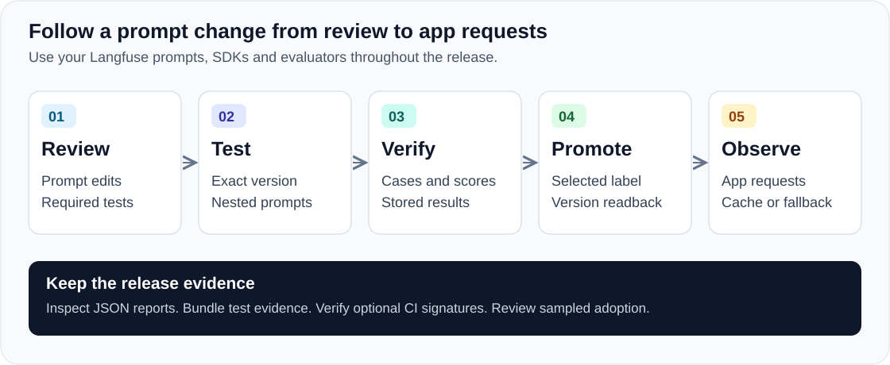

# Langfuse Prompt Release Tools

**Check that the prompt you release matches the one you tested, then see what your app received.**

Use this toolkit alongside Langfuse to review a prompt change, test the candidate through your application, and move a deployment label after your required checks pass. You can verify stored experiment results, inspect an interrupted release, and check which version your instrumented app requests received.

[Try the demo](#try-it-before-wiring-your-app) · [Get started](docs/getting-started.md) · [Customer workflows](docs/customer-workflows.md) · [Compare with native Langfuse](docs/langfuse-comparison.md) · [Download 0.8.0a1](https://github.com/AtharvaBondre/langfuse-prompt-release-tools/releases/tag/v0.8.0a1)



## Problems you can catch before and after a release

You tested a candidate on Tuesday. A teammate changes a shared prompt before you promote it on Wednesday. Or you move the `production` label and an app keeps serving a cached version. A passing evaluation alone leaves both questions open.

| Situation | Use this toolkit to… | What you can inspect |
|---|---|---|
| You evaluated one version, then selected another for release. | Compare the staged version and returned prompt content with the captured experiment. | Version identities, content hashes and failed checks. |
| Someone changed a prompt nested inside your candidate. | Lock the dependency graph used during evaluation and check it again around promotion. | The changed dependency and the release attempt it blocked. |
| Your experiment finished, but export lost a case or score. | Read the required cases and typed scores back from Langfuse before accepting remote persistence. | Separate local-completion and remote-persistence outcomes. |
| Your deployment command lost its connection. | Inspect the saved attempt and read the current server state before deciding what to do next. | Completed, pending, conflicting or unknown outcomes. |
| The label moved, but an app still uses an old prompt. | Compare instrumented SDK accesses with the released version and expected dependencies. | Cache/fallback details, missing consumers and time-window coverage. |
| Another reviewer or CI job needs the release evidence. | Verify a signed bundle again when promoting it on another machine. | Original bytes, independent signer expectations and a promotion receipt. |
| Your shell has credentials for a different project on the same server. | Compare the current key’s project with the independently selected destination before a release operation. | A blocked attempt with no release write. |

## Use it alongside Langfuse

Keep using Langfuse for prompt editing, versions, labels, experiments, datasets, traces and scores. Its official SDKs, CLI, MCP and GitHub integrations remain part of your stack.

Langfuse also provides CI regression gates and release-policy guidance. This repository supplies a connected implementation of the checks and handoffs around a release: reviewed requirements → captured prompt/dependencies → evaluation evidence → label promotion → observed application use.

| You already use | Add this project for |
|---|---|
| Langfuse prompt versions and deployment labels | A reviewed local snapshot and evidence checks before the selected label move. |
| SDK experiments or the official Experiment Action | A pinned set of required cases/checks, tied to the exact staged prompts your task fetched. |
| Prompt composition and SDK caching | Dependency drift checks and separate observations of cached, fresh or fallback use. |
| Your CI jobs and artifact storage | A portable release bundle and verification against a signer policy you select. |

You can build similar integrations from the official APIs and your own scripts. Use this repository to adopt and extend the existing commands, report formats, failure handling and tested examples. The [source-backed comparison](docs/langfuse-comparison.md) explains the overlap and the additional workflow we provide.

## Projects this can help

Use it for a support assistant with a JSON response contract, a RAG application with a shared system prompt, or an agent whose instructions change across releases. You supply the application task, dataset and evaluators. The toolkit checks the resulting release evidence.

The [worked scenarios](docs/customer-workflows.md) show the decisions you can support: promoting a shared prompt, checking app caches after release, handing evidence to another reviewer and investigating a lost deployment response. Each links to a reproducible check and explains what you need to supply for your app.

The Python and JavaScript capture hooks sit after the official SDK prompt fetch, before your framework transforms the prompt. Your task can use your chosen model or provider; adopting this project does not require changing inference providers. Framework wiring remains your application code.

For a small project that needs prompt editing and label updates, native Langfuse may cover the workflow you need. Add this toolkit when you want repeatable release checks, evidence handoffs or an explanation of which prompt an app used.

## Try it before wiring your app

**See a completed run:** the [live compatibility workflow](https://github.com/AtharvaBondre/langfuse-prompt-release-tools/actions/workflows/live-sdk.yml) runs real Langfuse servers and both official SDKs. Open a successful run, then its `summary.json` artifact to read the checks and outcomes.

**Run your own demo without an existing Langfuse account:**

1. Fork this repository and enable GitHub Actions in your fork.
2. Open **Actions → Live SDK compatibility → Run workflow**.
3. Open each job's artifact and read `summary.json` and `sanitized.log`.

The workflow starts disposable Langfuse instances on GitHub-hosted runners, creates test credentials, exercises the release process and removes its containers. It uses synthetic data and makes no model-provider calls. GitHub Actions usage follows your account's runner limits.

You will see a hosted dataset checked across pages, missing scores stay incomplete, schema changes block acceptance, a failing JavaScript evaluation block promotion, a nested prompt change invalidate an earlier evaluation, a cached app access differ from a fresh access, and two instrumented consumers complete a rollout window. The [guided demo](docs/getting-started.md#1-run-the-working-example) explains the output and the local Docker option.

## Install the commands

Use Python 3.10+ for the core commands. For the SDK examples, use Python 3.11+; add Node 22+ for JavaScript.

```bash
git clone https://github.com/AtharvaBondre/langfuse-prompt-release-tools.git
cd langfuse-prompt-release-tools
python3 -m venv .venv
source .venv/bin/activate
python -m pip install .
langfuse-release-pull --help
```

On Windows PowerShell, use `py -m venv .venv` and `.\.venv\Scripts\Activate.ps1` in place of the two environment commands above. The [release assets](https://github.com/AtharvaBondre/langfuse-prompt-release-tools/releases/tag/v0.8.0a1) include a Python wheel, source archive, JavaScript helper and checksums.

Install `.[example]` to run the Python SDK examples and run `npm ci --prefix js --ignore-scripts` for the JavaScript example. Signature verification uses the GitHub CLI, `gh`. The core Python package has no required third-party Python dependencies.

## Write fewer hashes and read fewer reports

Create a reviewable policy from selected cases and your task/evaluator source files:

```bash
langfuse-release-policy-draft --spec examples/policy-inputs/spec.json \
  --cases examples/policy-inputs/cases.json --source-root . --out policy-draft.json
langfuse-release-policy-draft --validate policy-draft.json
```

You choose the score types and thresholds before evaluating the candidate. The helper computes the fingerprints and checks the input fields. Review the draft, then use the separate policy-pin command. The [policy setup guide](docs/policy-setup.md) explains how to replace the example inputs.

For an existing release folder, inspect its saved evidence in one terminal view:

```bash
langfuse-release-status --workspace ./release-review
```

The [status report](docs/release-status.md) keeps evaluation, label promotion and observed application use separate. It reads local evidence without contacting Langfuse. Missing, conflicting or stale evidence stays visible; a historical success does not confirm current server state.

## Take it into your release process

Start with the [step-by-step guide](docs/getting-started.md). It shows the commands, where you add capture to your task, and which file each stage produces.

| Step | Your work | Guide |
|---|---|---|
| Review | Export the selected prompt and choose the dataset, evaluator thresholds and execution configuration. | [Policy and evidence](docs/experiment-evidence.md) |
| Stage and test | Create the candidate, record its dependencies, and run your task against its exact version. | [Integration recipe](docs/capture-integration.md), [JavaScript helper](js/README.md) |
| Verify and promote | Import the results, require remote persistence if your policy calls for it, then preview and apply the label move. | [Getting started](docs/getting-started.md#3-run-a-release-with-your-own-app), [remote verification](docs/remote-persistence.md) |
| Review application use | Capture SDK accesses and check the consumers, versions and time windows you chose. | [Adoption](docs/dependencies-and-adoption.md), [rollout windows](docs/rollout-observation.md) |
| Share or recover | Transfer test evidence, verify CI identity, or inspect an interrupted attempt. | [Trusted promotion](docs/trusted-promotion.md), [recovery](docs/local-recovery.md) |

### Read a release outcome

This example shows how to read three separate JSON reports. Version numbers are illustrative; this is not output from a combined status command.

| Report | Example result | Your next step |
|---|---|---|
| Evaluation | Required checks passed for prompt version 18. | Review the promotion preview. |
| Promotion | The selected label points to version 18. | Check application observations. |
| Adoption | One consumer returned version 17 with caching enabled: `not_adopted`. | Inspect that consumer's cache and deployment before declaring its rollout complete. |

You get the distinction between a passing experiment, a changed label and observed app use. Keep the reports together so a teammate can follow the release without reconstructing your terminal session.

## Validation and next work

The 0.8 update adds project checks before writes, signed evidence at promotion, durable local recovery records, supported Python/JavaScript result helpers and a bounded persistent JavaScript collector. The [migration guide](docs/migration-v08.md) explains the new project ID requirement and the explicit unsigned-local option.

The [validation record](docs/validation.md) lists tested versions and separates offline checks, real SDK/server runs and signed CI evidence. Hosted datasets have their own [reproducible scenario](docs/hosted-dataset-validation.md). These checks use synthetic applications and make no model-provider calls.

This remains an alpha. Application observations cover the requests you instrument; a local lock cannot prevent another machine from changing a label. We have deferred the existing-application pilot until an app/test environment is available, including measurement of capture overhead. See the [roadmap](docs/roadmap.md) for what is shipped and what still needs real-user evidence.

## Project and contributions

Atharva Bondre maintains this independent MIT project. It grew from the [original prompt-release Gist](https://gist.github.com/AtharvaBondre/3ad9d0654b5450d1e007728f67047fa0). Langfuse names identify the platform we integrate with; this is a community project.

If you try it, an [issue](https://github.com/AtharvaBondre/langfuse-prompt-release-tools/issues) with the SDK/server versions, redacted report and step that confused you will help improve the next release. See [contributing](CONTRIBUTING.md), [security](SECURITY.md), the [agent skill](skills/langfuse-prompt-release/SKILL.md), and [all seventeen commands](PACKAGING.md).

For Langfuse maintainers and contributors, the [community contribution guide](docs/community-contributions.md) identifies small examples, contract tests and release checks that could be reused upstream. Each proposal needs a reproduction and acceptance evidence before we ask anyone to adopt it.
