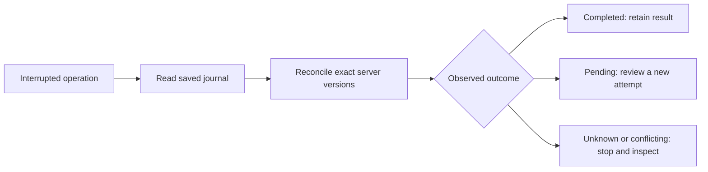

# Concurrent operations and interrupted releases

If a terminal closes while a release is running, first preserve the folder and inspect its last report. Do not rerun a creation command just because you did not receive a success message.

`langfuse-release-reconcile` reads the current server state and writes a separate report with a `resume_proposal`. It never creates a version, moves a label or rolls back. See [reconciliation](reconciliation.md) for the classifications and command.

The journal records `submitting` before sending a remote write and records the returned version before verification. If the process dies after the server accepts a request but before the response is saved, that gap remains visible. Reconciliation does not guess the original writer from matching prompt text.

One toolkit operation holds `.release.lock` for the whole snapshot operation. Concurrent publish, promote or reconcile attempts fail before remote activity. Locks are cooperative and local: they do not provide a Langfuse transaction or coordinate other machines. The operating system releases a lock after process death. Keep the file; deleting it can let two processes lock different files at the same path.

Each JSON update is flushed to storage before its atomic replacement. POSIX directory entries are synchronized too. Windows receives file synchronization and atomic replacement, with no portable directory-sync guarantee. These checks do not override the durability behavior of a network filesystem or storage device.

The test suite kills subprocesses at operation boundaries, verifies that the lock is released, and checks that an uncertain create stays a read-only recovery case. Test reports use synthetic servers; they do not prove distributed exclusion.
